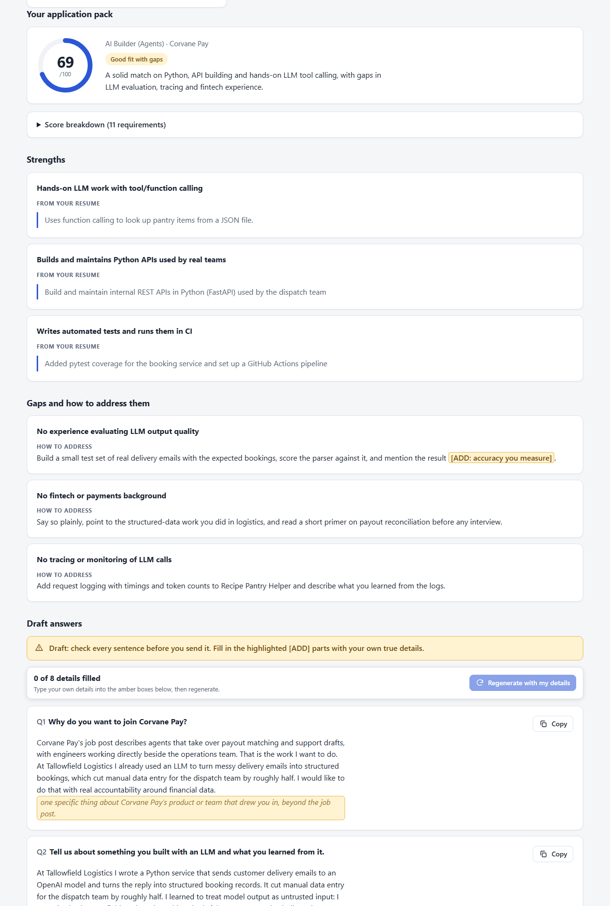

# Job Application Agent

A local, privacy-first agent that reads a job post and your CV, scores your fit with evidence, and drafts honest answers and a cover letter, asking you to fill in anything it can't prove.



*Screenshot of the results view, taken in demo mode (a scripted fake model on the fictional files in `samples/`).*

## What you get

Paste a job post (text or URL), your resume (text or PDF/TXT/MD upload) and optional application questions, one per line. Watching the agent work step by step, you get an application pack:

- a 0-100 fit score with a per-requirement breakdown
- strengths, each backed by a quote from your resume
- gaps, each with a concrete way to address it
- a drafted answer to every question
- a full cover letter (the agent is asked for 250-350 words)

Anything the agent can't know is an `[ADD: ...]` blank. Type your own details into the highlighted blanks and press **Regenerate with my details**, or ask for changes in the chat ("make answer 2 shorter"). **Stop** works at any time.

## How it works

The agent loop is hand-written in [app/agent.py](app/agent.py), with no agent framework. **The model decides, the code executes:** each turn the model either answers or asks for a tool; the code runs the tool, appends the result and calls the model again. Every step is logged as an event and streamed live to the page (Server-Sent Events). A turn is capped at 12 model calls, and if the model dithers, the last two steps force the tools that finish the run.

The five tools ([app/tools.py](app/tools.py)), and why each is a tool instead of something the model does itself:

| Tool | Why it's a tool |
|---|---|
| `fetch_webpage` | The model can't browse. Code does the request and refuses non-public addresses (localhost, private networks), re-checking every redirect hop. |
| `lookup_company` | Gives real, sourced facts (Wikipedia) instead of the model's memory about the employer. Small companies often have no page; the agent is told to carry on without one. |
| `check_resume_for` | Plain text search of your resume, so "is this skill in the CV?" is evidence, not an opinion. |
| `calculate_fit_score` | Arithmetic belongs in code. The model rates each requirement `strong`/`partial`/`missing`; the code does the maths. |
| `save_application_pack` | The gate. It runs the honesty check below before anything is saved, and attaches the score from the calculator, never from the model. |

**Scoring rule:** each requirement is a "must" (weight 2) or a "nice" (weight 1); a strong match earns full weight, a partial match half, a missing one nothing. Score = earned / possible x 100, rounded. 75+ with no missing must-have is "Strong fit", 50+ is "Good fit with gaps", below that "Stretch role". The score is frozen once the pack is saved: the calculator refuses to run again and is no longer offered to the model, so later edits and your added details can't change it.

## How it stays honest

The system prompt forbids inventing experience, and `save_application_pack` backs that up with deterministic checks in code:

- every strength's evidence must be an exact quote from your resume (case and whitespace ignored)
- every number in the summary, strengths, gaps, answers and cover letter must appear in your resume, the job post, or details you typed in yourself
- a fixed list of feeling phrases ("I enjoy", "excited", "passionate", ...) is rejected outside an `[ADD: ...]` blank, unless your resume says it
- if the check fails, the agent gets the exact issues and retries. Retries are bounded (two rejections), after which the pack is saved **with the warnings shown to you** rather than looping forever
- the job post, resume and fetched pages are fenced as data, and the prompt tells the model to ignore instructions inside them

**The honest limit:** these checks catch invented quotes, numbers and stated feelings. They can't verify every claim: a sentence like "I profiled the endpoint" has no number or feeling to catch. The prompt asks the model not to invent such details, but that is a request, not a guarantee, and the prompt-injection rule is likewise a mitigation, not a proof. The page labels the draft "check every sentence before you send it", and you should. The cover-letter length is also only requested from the model, not enforced.

## Privacy

- The server binds to `127.0.0.1:8000` only, and rejects requests whose `Host` header isn't `127.0.0.1` or `localhost` (against DNS-rebinding from other websites).
- No database, accounts or analytics. Sessions live in memory and disappear when you stop the app. The app's own code never writes your resume or the pack to disk. (One caveat: the web framework may spool an uploaded file larger than 1 MB to a temporary file while receiving it; the app reads it into memory and doesn't keep it.)
- What leaves your machine: the text you submit goes to **the model provider you chose**. Two optional tools also make web requests: `fetch_webpage` fetches the job-post URL if you pasted a link, and `lookup_company` sends the company name to Wikipedia. With a local Ollama model the model call stays on your machine; those two tools are the only network use, and neither sends your resume.
- Secrets live in `.env`, which is git-ignored.

## Quick start

You need Python 3.11+ and a model. Free options: a Gemini free-tier key from <https://aistudio.google.com/apikey>, or a local [Ollama](https://ollama.com) model. Developed and tested on Windows.

**Windows (PowerShell)**

```powershell
python -m venv .venv
.\.venv\Scripts\Activate.ps1
pip install -r requirements.txt
Copy-Item .env.example .env   # then edit .env: set LLM_MODEL and that provider's key
python run.py                 # opens http://127.0.0.1:8000
```

**macOS / Linux**

```bash
python3 -m venv .venv
source .venv/bin/activate
pip install -r requirements.txt
cp .env.example .env          # then edit .env: set LLM_MODEL and that provider's key
python run.py
```

**Try it without any key:** `FAKE_LLM=1 python run.py` (PowerShell: `$env:FAKE_LLM = "1"; python run.py`) uses a scripted fake model on the `samples/` files. Add `FAKE_DELAY=1` to slow it down so the live timeline is visible.

### Choosing a model

Calls go through [LiteLLM](https://github.com/BerriAI/litellm), so you pick the model with `LLM_MODEL` in `.env`, plus that provider's key. The model must support tool calling. The default is `gemini/gemini-3.5-flash`.

| Provider | `LLM_MODEL` (example) | Key in `.env` |
|---|---|---|
| Gemini (default) | `gemini/gemini-3.5-flash` | `GEMINI_API_KEY` |
| OpenAI | `openai/gpt-4o-mini` | `OPENAI_API_KEY` |
| Anthropic | `anthropic/claude-sonnet-5-5` | `ANTHROPIC_API_KEY` |
| Groq | `groq/llama-3.3-70b-versatile` | `GROQ_API_KEY` |
| OpenRouter | `openrouter/<vendor>/<model>` | `OPENROUTER_API_KEY` |
| Ollama (local) | `ollama/qwen3:8b` | none |

**Only Gemini has actually been tested end to end.** The other providers are wired through the same LiteLLM call and the app checks that the right key is set, but I haven't run them. The model names above are examples; check your provider for current ones. `python scripts/smoke_llm.py` checks that your key works.

Optional: set `CONTACT_URL` in `.env` to your repo URL or email. It goes in the User-Agent of the Wikipedia lookups, whose policy asks for a contact.

## Tests

```powershell
python -m pytest
```

115 tests, no real model calls and no API key needed (the loop is tested against a scripted fake model). They cover: the agent loop (forced finishing, empty replies, bad tool calls, Stop at each checkpoint), the five tools and the scoring maths, the honesty check, the retry/backoff rules in the LiteLLM wrapper, and the API (validation, SSE streaming, chat, regenerate, uploads, Host-header refusal).

You can also run the agent in the terminal on the sample files: `python scripts/run_cli.py`.

## Limits and what I'd build next

Limits today:
- Quality depends on the model you choose, and only Gemini has been tried.
- Scanned PDFs have no text to extract; paste the text instead. Job pages that need JavaScript can't be read; paste the post.
- Resume and job post are capped at 30,000 characters each, uploads at 5 MB, questions at 10.
- Stop abandons a model request that is already in flight; the provider may still finish and bill it.
- The URL check in `fetch_webpage` resolves the host, then connects, so a hostile DNS server could answer differently the second time (DNS rebinding). This only matters for a malicious job URL pasted on your own machine.
- One user on one machine, by design.

Next:
- a verifier pass that checks every claim in the draft against the CV
- per-requirement evidence in a visual match strip
- the UI redesign
- export to `.docx`

## Layout

```
app/main.py       routes + Server-Sent Events
app/agent.py      system prompt, Session, the agent loop
app/tools.py      the five tools + their schemas (OpenAI function-calling format)
app/llm.py        LiteLLM wrapper; the only file that knows about providers
app/fake_llm.py   scripted fake model for FAKE_LLM=1
static/index.html the single page (vanilla JS and CSS, no build step)
scripts/          smoke_llm.py (check your key), run_cli.py
samples/          fictional resume, job post and questions
tests/            pytest suite
```

## License

MIT, see [LICENSE](LICENSE). Built with Claude Code.
